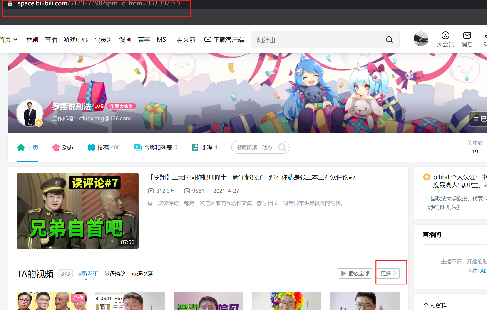
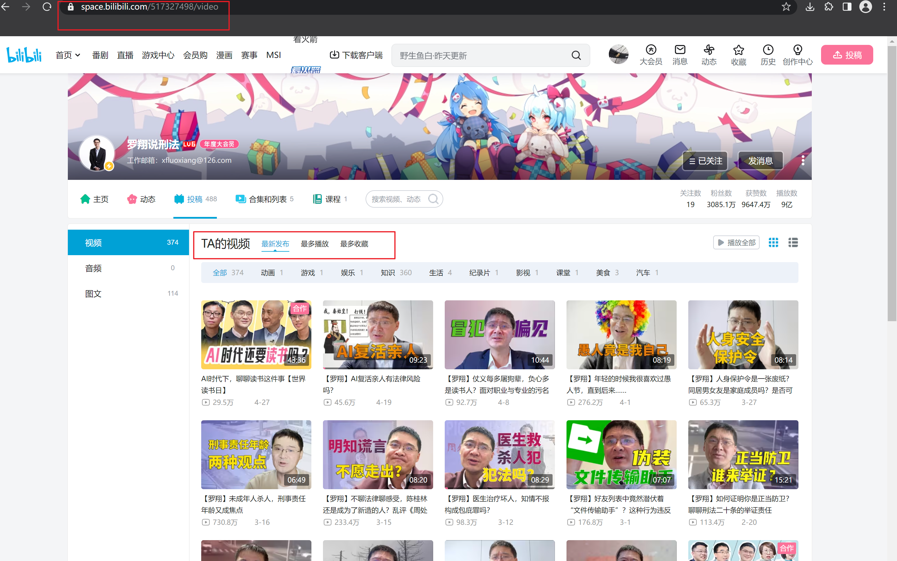
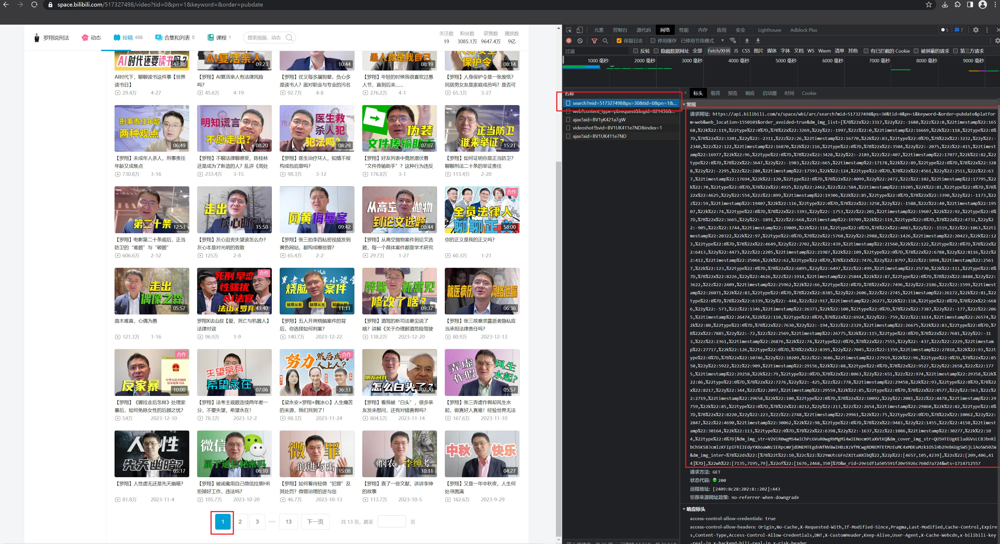

# bilibiliDownload

## 介绍：
哔哩哔哩下载脚本，仅供学习参考。切勿传播，小心吃官司。<br/>

## 运行环境：
1. Deno 1.38.2 及以上版本;
2. FFmpeg 6.1 (由于哔哩哔哩 视频 和 音频 是分开的，下载后需要合并，如果不想合并，可以不下载 FFmpeg)；
3. Mac Os（windows 应该也行，没试）。

## 安装教程：
1.  下载 Deno https://www.denojs.cn/#installation
2.  下载 FFmpeg https://ffmpeg.org/download.html
3.  安装脚本
```shell
deno install --allow-all --name bili <入口文件路径（index.js）>
```
4.  如果对代码有修改，需更新（重新安装）：
```shell
deno install -f --allow-all --name bili <入口文件路径（index.js）> 
```

## 使用说明：
1.  <font color=orangered>**第一次使用前请先设置 cookie**</font> <br/>如果不设置cookie，也可以下载，但分辨率很低。
```shell
bili --cookie 'your cookie...(请求头cookie)'
```
2. 下载单个视频
```shell
bili --url 'https://www.bilibili.com/video/BV1zE41197kV?p=17&vd_source=a3309e57c732073f94bc3088bdc0bf96(要下载的视频链接)' 
```

3. 一整页的视频
```shell
bili --user '(获取本页面的所有视频的接口，打开控制台，找到接口，复制即可，是一个“https://api.bilibili.com/x/space/wbi/arc/search?” 开头的接口)'

如：bili --user 'https://api.bilibili.com/x/space/wbi/arc/search?mid=1&pn=1&ps=30&order=pubdate&jsonp=jsonp'
```

4. 如何找到接口：本页所有视频的接口
   1. 首先找到正确的页面
      1. 进入作者主页；
      2. “更多”按钮；
      3. 如图：
   2. 可以筛选自己喜欢的排序；
   3. 打开控制台，找到接口，复制即可；
    ```shell
    方法：打开哔哩哔哩网页，找到你要下载的视频页面；
    1. 按 F12 打开控制台；
    2. 点击 Network 选项卡；
    3. 刷新页面；
    4. 在过滤器中输入 “arc”；
    5. 找到一个请求，点击它；
    6. 在 Headers 选项卡中找到 Request URL，复制它。
    ```


### 参考资料:
*https://www.bilibili.com/read/cv6415114*

*https://juejin.cn/post/7253969759191023675*

*https://stackoverflow.com/questions/64398431/how-to-console-log-without-a-newline-in-deno*

*https://www.cnblogs.com/taohuaya/p/16427408.html*
